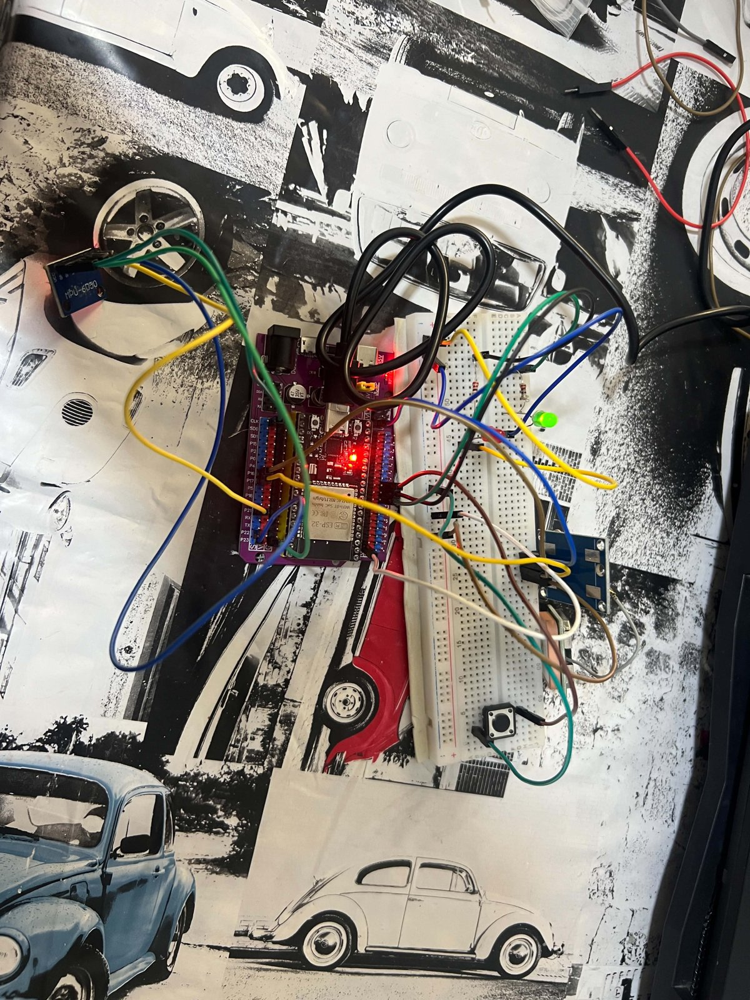
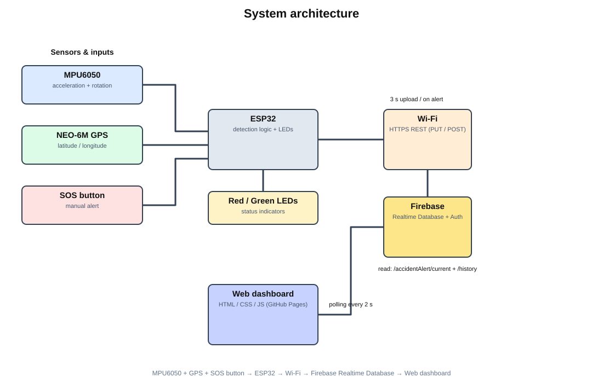
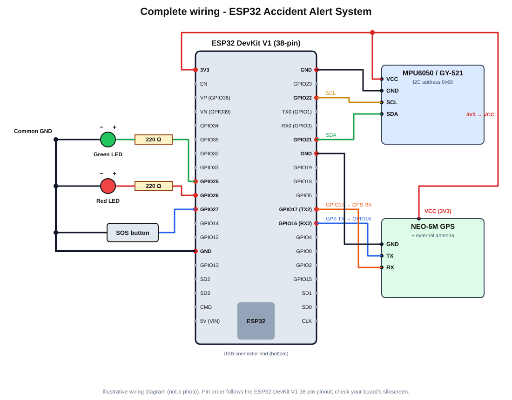
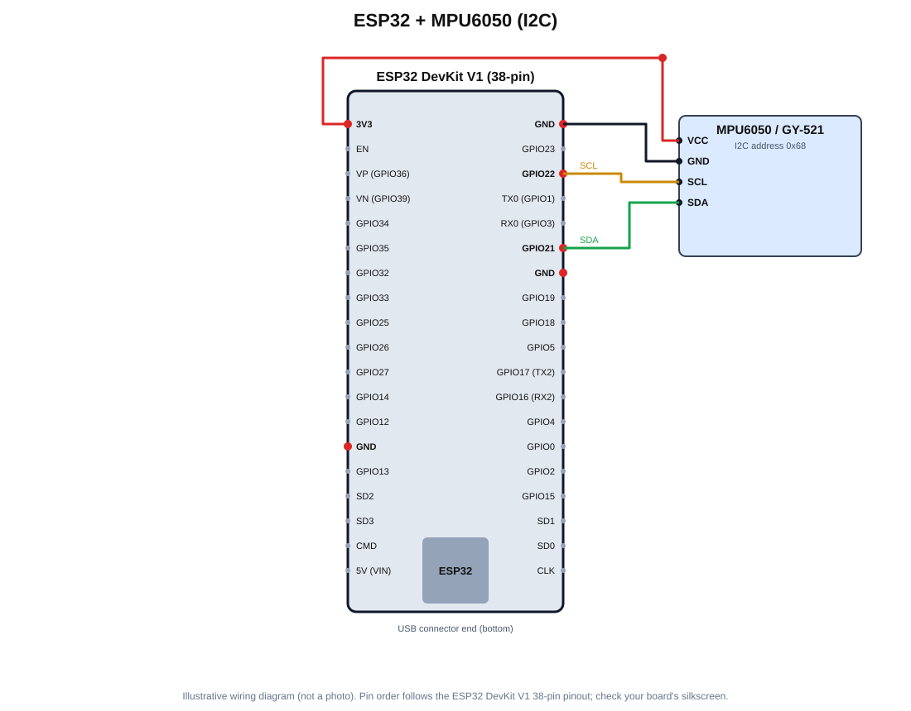
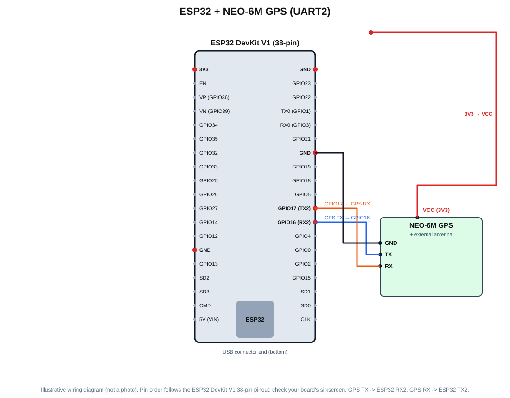
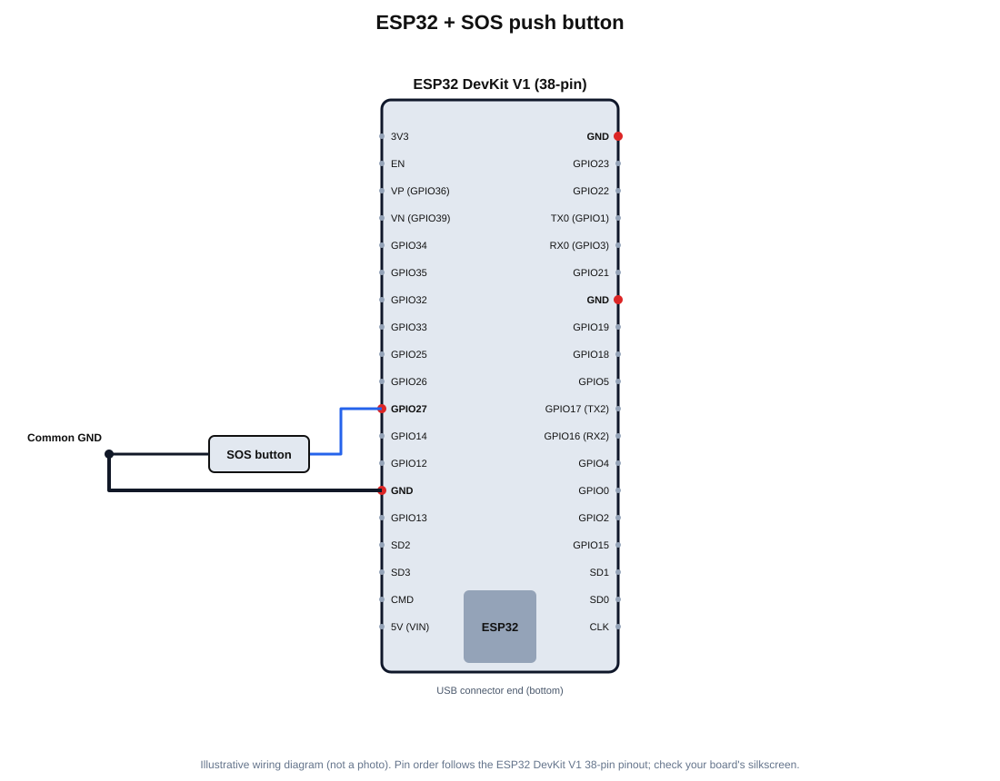
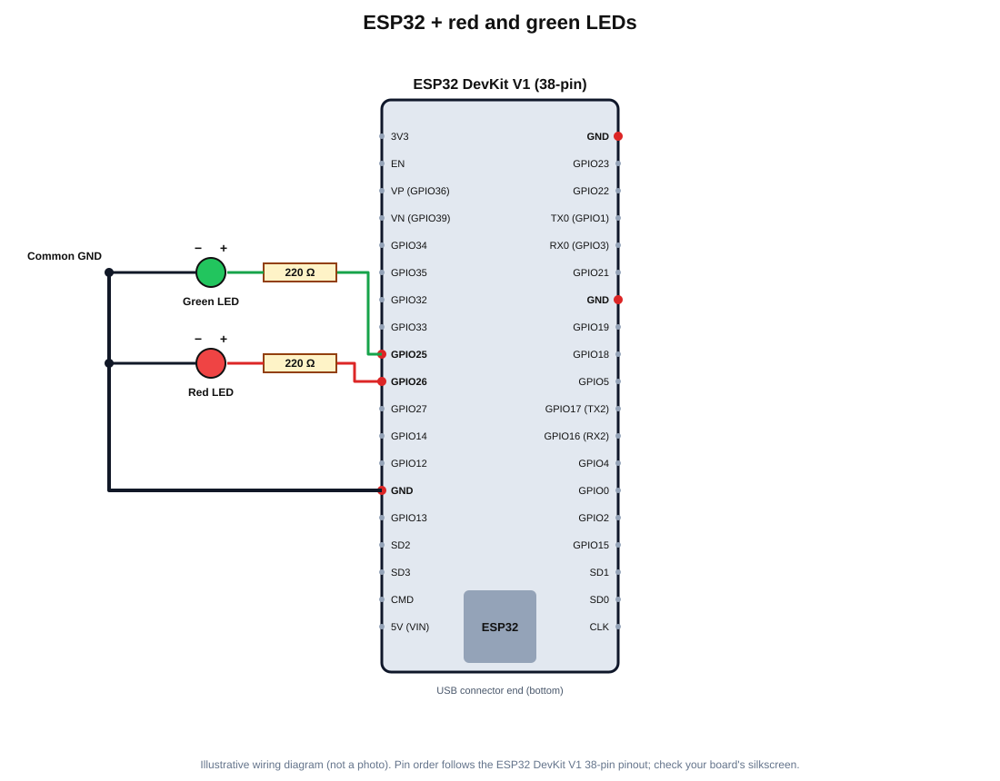
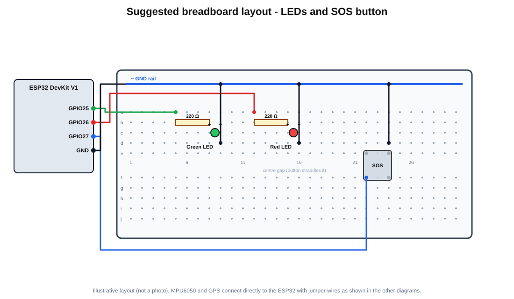

# Accident Detection & Emergency Alert System Using ESP32, MPU6050, GPS and Firebase

An ESP32-based prototype that detects possible accidents from motion data, lets the user raise a manual SOS, and publishes the status and GPS position to a Firebase Realtime Database. A responsive web dashboard displays everything in real time.

> **Educational prototype.** This is a university/learning project. It is **not** a certified emergency or safety system and must not be relied on to save lives. Detection thresholds require calibration.


*Real photo of the prototype circuit (ESP32 breakout board, MPU6050, NEO-6M GPS, breadboard with LEDs and SOS button).*

---

## Table of contents
1. [Project description](#project-description)
2. [Main features](#main-features)
3. [System architecture](#system-architecture)
4. [Hardware list](#hardware-list)
5. [Wiring and connections](#wiring-and-connections)
6. [Software requirements](#software-requirements)
7. [Installation and configuration](#installation-and-configuration)
8. [GPS testing](#gps-testing)
9. [Firebase configuration and security](#firebase-configuration-and-security)
10. [Website deployment (GitHub Pages)](#website-deployment-github-pages)
11. [Testing](#testing)
12. [Limitations and future improvements](#limitations-and-future-improvements)
13. [Repository structure](#repository-structure)
14. [License](#license)

---

## Project description

**Purpose.** After a road accident, help may be delayed because nobody knows that it happened or where. This project demonstrates a low-cost device that notices a violent shock or rotation, marks an alert, and reports the location so that a remote person can see it.

**How accident detection works.** The motion sensor is read continuously. The ESP32 computes the total acceleration (in m/s², 1 g ≈ 9.81 m/s²) and the total rotation rate (in °/s). If acceleration exceeds `ACCEL_THRESHOLD` (30 m/s²) the alert type becomes `POSSIBLE_ACCIDENT_ACCELERATION`; if rotation exceeds `GYRO_THRESHOLD` (300 °/s) it becomes `POSSIBLE_ACCIDENT_ROTATION`. The alert lasts 10 seconds, then the system returns to `NORMAL`.

**How GPS provides location.** A NEO-6M module streams NMEA sentences over UART2. The `TinyGPSPlus` library decodes them. Coordinates are sent to Firebase **only while the fix is valid and fresh** (less than 10 s old); otherwise `gpsValid` is `false` and latitude/longitude are `null`. The dashboard never shows placeholder coordinates.

**How the SOS button works.** The button is momentary. While it is pressed the alert type is `MANUAL_SOS` and the red LED is on; releasing it returns to `NORMAL` (unless an automatic alert is active).

**How Firebase stores information.** Every 3 seconds (and immediately on any alert change) the ESP32 writes the current state to `/accidentAlert/current`. Each new alert is also appended once to `/accidentAlert/history`.

**How the website displays alerts.** The dashboard polls the same database every 2 seconds and shows the status (Normal / Possible accident / Manual SOS), sensor values, GPS data, a Google Maps button, device online/offline state and the latest alerts.

## Main features

- Automatic accident detection from acceleration and rotation thresholds
- Manual SOS push button
- Green LED (normal) / red LED (alert)
- NEO-6M GPS location with validity and freshness checks
- Upload to Firebase Realtime Database every 3 s, plus immediate upload on alert changes
- Alert history (`/accidentAlert/history`)
- Automatic recovery from Wi-Fi and Firebase failures (reconnect, timeouts, retry)
- Simple setup: only the Firebase database URL is needed (no API key, no login)
- Responsive dashboard (desktop and mobile), no backend server, no external libraries
- Serial Monitor diagnostics and test commands
- No credentials stored in the repository

## System architecture

```text
MPU6050 + GPS + SOS Button  →  ESP32  →  Wi-Fi  →  Firebase Realtime Database  →  Web Dashboard
```


*Illustrative diagram.*

## Hardware list

| Qty | Component | Purpose |
|---|---|---|
| 1 | ESP32 DevKit V1 (38-pin) | Main controller with Wi-Fi |
| 1 | MPU6050 module (GY-521) | Accelerometer + gyroscope |
| 1 | NEO-6M GPS module with external antenna | Location |
| 1 | Breadboard | Mounting LEDs, resistors, button |
| 1 | Red LED | Accident / SOS indicator |
| 1 | Green LED | Normal-operation indicator |
| 2 | 220 Ω or 330 Ω resistors | LED current limiting |
| 1 | SOS push button | Manual emergency alert |
| – | Jumper wires | Connections |
| 1 | USB cable | Power and programming |

> **Note on the motion sensor.** The firmware uses the `MPU6500_WE` library. Many modules sold as "MPU6050" actually contain an MPU6500-compatible chip, which is the case for the prototype in this project. If the Serial Monitor reports *"Motion sensor NOT DETECTED"* even though the wiring is correct, your chip is a genuine MPU6050: replace the library and class with `MPU6050_light` or `Adafruit_MPU6050` (the rest of the logic is unchanged).

## Wiring and connections

All components **must share a common GND**. The ESP32 pin order below follows the standard DevKit V1 38-pin pinout; always check the silkscreen of your own board. The photographed prototype uses a breakout/expansion board, but the GPIO numbers are the same.


*Illustrative wiring diagram (not a photo of the real circuit).*

### MPU6050

| MPU6050 pin | ESP32 pin |
|---|---|
| VCC | 3V3 |
| GND | GND |
| SDA | GPIO 21 |
| SCL | GPIO 22 |



### NEO-6M GPS

| GPS pin | ESP32 pin |
|---|---|
| VCC | 3V3 (most NEO-6M boards also accept 5 V through their on-board regulator; check your module's documentation before using VIN/5V) |
| GND | GND |
| TX | GPIO 16 (ESP32 RX2) |
| RX | GPIO 17 (ESP32 TX2) |

TX and RX are **crossed**: the GPS transmits into the ESP32's receive pin.



**Antenna placement.** Connect the external antenna and place it with a clear view of the sky (outdoors or on a window sill). Indoors a fix is often impossible. The first fix after power-up (cold start) can take several minutes.

### SOS button

| Button terminal | ESP32 pin |
|---|---|
| One terminal | GPIO 27 |
| Other terminal | GND |

The firmware uses `INPUT_PULLUP`, so no external resistor is needed (pressed = LOW).



### LEDs

| LED | Anode (+) | Cathode (−) |
|---|---|---|
| Green (normal) | GPIO 25 through 220 Ω / 330 Ω | GND |
| Red (alert) | GPIO 26 through 220 Ω / 330 Ω | GND |

The longer LED leg is the anode (+).



### Suggested breadboard layout


*Illustrative layout. The real prototype (photo above) wires the same connections differently.*

## Software requirements

- [Arduino IDE](https://www.arduino.cc/en/software) 2.x
- ESP32 board package by Espressif (Boards Manager)
- Libraries (Library Manager): **MPU6500_WE** (Wolfgang Ewald), **TinyGPSPlus** (Mikal Hart). `WiFi`, `WiFiClientSecure`, `HTTPClient` and `Wire` come with the ESP32 package.
- A Google account for Firebase (Realtime Database, Spark free plan is enough)
- A modern web browser

## Installation and configuration

1. **Clone or download** this repository: `git clone https://github.com/YOUR_USERNAME/Accident-Alert-System.git`
2. Open `ESP32/AccidentAlert/AccidentAlert.ino` in the Arduino IDE.
3. **Install the libraries** listed above.
4. **Select the board:** *Tools → Board → ESP32 Arduino → ESP32 Dev Module* and the correct COM port.
5. **Wi-Fi credentials:** in the sketch folder copy `config.example.h` to `config.h` and set `WIFI_SSID` and `WIFI_PASSWORD` (2.4 GHz network). `config.h` is ignored by Git.
6. **Create a Firebase project** at <https://console.firebase.google.com>.
7. **Create a Realtime Database** (*Build → Realtime Database → Create database*).
8. **Copy the database URL** (shown at the top of the *Data* tab), e.g. `https://YOUR_PROJECT_ID-default-rtdb.firebaseio.com`.
9. **ESP32 Firebase settings:** set `FIREBASE_URL` in `config.h`. 
10. **Website Firebase settings:** edit `docs/config.js` with the same `FIREBASE_URL`.
11. **Upload** the sketch to the ESP32 and open the Serial Monitor at **115200 baud**.
12. **Open the website:** open `docs/index.html` in a browser (or use GitHub Pages) .
13. **Test** the system as described in [Testing](#testing).

## GPS testing

1. Connect only the GPS first, take the antenna outdoors and power the ESP32.
2. Open the Serial Monitor (115200). The `[GPS]` block prints *Characters received*. If the counter does not increase, TX/RX are swapped or power is missing.
3. Without a fix the monitor shows `Waiting for GPS fix...`. The GPS module's own LED usually blinks once per second when a fix is obtained.
4. A **valid fix** prints latitude, longitude, satellites (4 or more is typical), and a Google Maps link you can open to compare with your real position. Press `g` in the Serial Monitor for a quick position check.

GPS signals are weak microwave signals that are blocked by roofs and walls, which is why a clear sky view is required.

## Firebase configuration and security

### Database structure

```json
{
  "accidentAlert": {
    "current": {
      "status": "NORMAL",
      "alertType": "NORMAL",
      "acceleration": 9.91,
      "rotation": 2.1,
      "temperature": 26.32,
      "gpsValid": false,
      "latitude": null,
      "longitude": null,
      "satellites": 0,
      "uptime": 99,
      "updatedAt": 1700000000000
    },
    "history": { "-Nxxxx": { "...": "same fields, one entry per alert" } }
  }
}
```

`alertType` is one of `NORMAL`, `MANUAL_SOS`, `POSSIBLE_ACCIDENT_ACCELERATION`, `POSSIBLE_ACCIDENT_ROTATION`, `TEST_ALERT`. `updatedAt` is a server timestamp (ms) used by the dashboard to detect an offline device.

### Database rules

The ESP32 and the website use only the database URL, so the rules must allow access without login. Limit the access to the `accidentAlert` path and keep everything else closed:

```json
{
  "rules": {
    ".read": false,
    ".write": false,
    "accidentAlert": {
      ".read": true,
      ".write": true
    }
  }
}
```

**Security warning.** With these rules anyone who knows your database URL can read your GPS position and write fake alerts. This is acceptable for a classroom demo, but:
- Do not publish the real URL in the repository (use the placeholder; keep the real one in `config.h` and in your local `config.js`).
- Do not use these rules for a real deployment. Use Firebase Authentication with rules such as `"auth != null"` instead.
- Never commit `config.h`, passwords or service-account files.
- The ESP32 uses `setInsecure()` (TLS certificate not verified), which is acceptable only for a prototype.

## Website deployment (GitHub Pages)

1. Edit `docs/config.js` with your database URL. Remember that a GitHub Pages site is public, so the URL will be visible to everyone; use a throw-away test database and delete the data when finished.
2. Push the repository to GitHub.
3. *Settings → Pages →* Source: **Deploy from a branch**, Branch: `main`, folder: `/ (root)`. GitHub Pages can only serve `/` or `/docs`, so either use the root with the page at `https://YOUR_USERNAME.github.io/Accident-Alert-System/docs/`, or move the three website files to `docs/` and select `/docs`.
4. Open the published URL.

## Testing

| Test | How | Expected result |
|---|---|---|
| Normal operation | Power on, leave the board still | Green LED on, status `NORMAL`, acceleration ≈ 9.8 m/s² |
| Motion detection | Shake or rotate the sensor sharply; or press `t` in Serial Monitor for a test alert | Red LED, `POSSIBLE_ACCIDENT_…`, alert appears in history, returns to normal after 10 s |
| Manual SOS | Hold the button | Red LED, `MANUAL_SOS` while pressed |
| GPS | Go outdoors, wait for a fix | `gpsValid: true`, real coordinates; Maps button enabled |
| Firebase | Watch the console *Data* tab | `current` refreshes about every 3 s |
| Dashboard | Open the website | Values update every 2 s; unplug the ESP32 and the dashboard shows *OFFLINE* after ~20 s |

**Calibration.** Thresholds depend on sensor mounting and range (±16 g / ±500 °/s are configured). Log real values with the Serial Monitor and adjust `ACCEL_THRESHOLD` and `GYRO_THRESHOLD`; carrying the device or knocking it on a table can produce false alarms.

Features that cannot be fully verified without hardware: real GPS fixes, the actual accident thresholds, and Firebase writes with your own project.

## Limitations and future improvements

- Thresholds are simple and not validated on real crash data; false positives/negatives are possible
- Needs Wi-Fi: no cellular (GSM/LTE) fallback
- GPS needs a clear sky view; no indoor positioning
- Certificate verification is disabled on the ESP32 (prototype)
- No SMS/e-mail/push notification
- Future: crash-pattern detection (impact followed by stillness), GSM module, battery management and enclosure, root-CA pinning, push notifications, map embedded in the dashboard

## Repository structure

```text
Accident-Alert-System/
├── README.md
├── LICENSE
├── .gitignore
├── ESP32/AccidentAlert/
│   ├── AccidentAlert.ino
│   └── config.example.h        (copy to config.h)
├── docs/
│   ├── index.html
│   ├── style.css
│   ├── script.js
│   └── config.js
├── assets/
│   ├── *.svg                   (illustrative diagrams)
│   └── project-photos/         (real photos)
└── INSTALLATION.md
```

## License

Released under the [MIT License](LICENSE). Copyright (c) GHARRAD Khalil.
